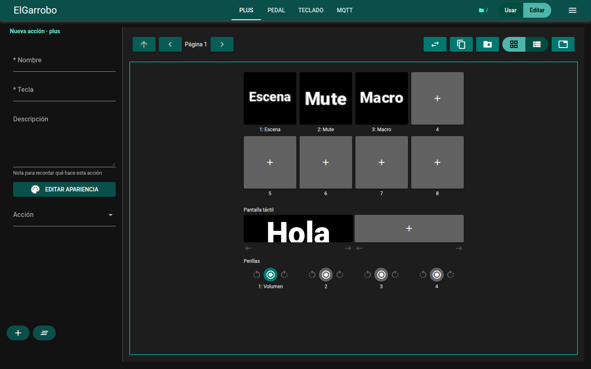
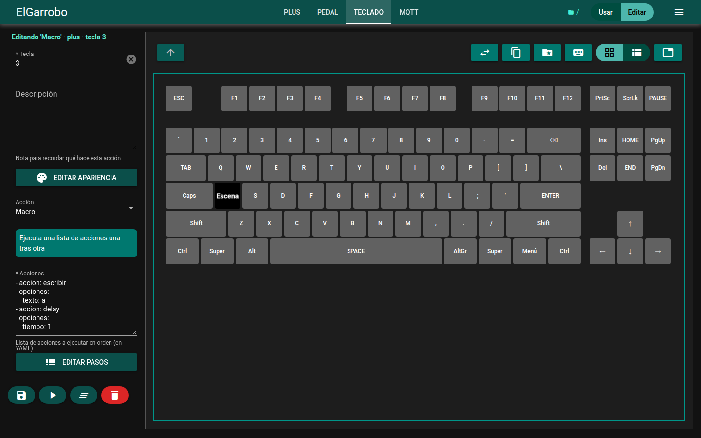
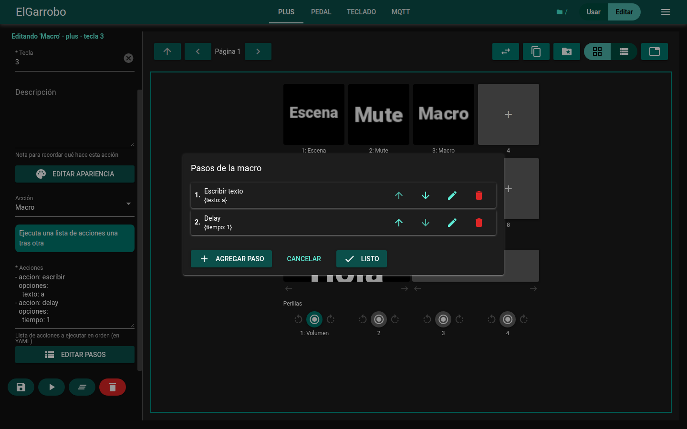

# ElGarrobo

Herramienta de macros para Linux: convierte cualquier tecla de un **StreamDeck**, **teclado USB**, **pedal** o un mensaje **MQTT** en una acción (abrir un programa, escribir texto, cambiar escena de OBS, reproducir un sonido, encadenar varias acciones, etc.). Se configura desde una interfaz web o editando archivos `.md`.



| Teclado USB con su forma real | Macro: varias acciones en orden |
|---|---|
|  |  |

## Compatible con

- Linux con Python 3.8 o superior
- Teclados USB (cualquiera, incluso varios a la vez)
- Elgato StreamDeck (incluye Pedal y StreamDeck+)
- MQTT (como dispositivo de entrada y como acción)
- OBS por WebSocket

## Instalación rápida

```bash
# 1. Dependencias del sistema (Debian / Ubuntu / Linux Mint)
sudo apt install -y git python3-pip python3-dev python3-tk pipx ffmpeg xdotool libasound2-dev

# 2. Clonar con submódulos
git clone --recurse-submodules https://github.com/chepecarlos/ElGarrobo
cd ElGarrobo

# 3. Instalar (con pipx) y crear el servicio, el ícono de la barra y la entrada en el menú
pipx ensurepath
make install

# 4. Permiso para leer teclados USB, después reinicia la sesión
sudo usermod -a -G input $USER
```

Para StreamDeck, audio, voz y otros extras ver la [Guía de instalación](./Guia_Instalacion.md). También puedes usar `make extras` para instalar todos los paquetes del sistema.

## Primer uso

```bash
elgarrobo -g          # inicia con la interfaz gráfica
elgarrobo abrir-gui   # abre http://localhost:8080 en el navegador
```

Desde la interfaz web puedes ver tus dispositivos, asignar acciones a cada tecla y activar módulos sin tocar archivos.

Otros comandos útiles:

```bash
elgarrobo                        # modo normal (sin GUI si no está activada)
elgarrobo -d                     # con mensajes de depuración
elgarrobo dispositivos info      # lista dispositivos y su estado
elgarrobo dispositivos activar gui
elgarrobo modulos info           # lista módulos (OBS, estado PC, impresoras 3D...)
elgarrobo modulos activar obs
elgarrobo --help
```

Si instalaste con `make install`, ElGarrobo arranca solo al iniciar sesión (ícono en la barra de estado). Para quitarlo: `make uninstall`.

## Configuración

Todo vive en `~/.config/elgarrobo/`:

| Archivo | Para qué |
|---|---|
| `dispositivos.md` | Qué dispositivos están activos (`teclado`, `deck_combinado`, `pedal`, `mqtt`, `gui`) |
| `modulos.md` | Qué módulos están activos (`obs`, `estado_pc`, ...) |
| `teclados.md` | Lista de teclados USB: nombre, ruta en `/dev/input/by-id/` y archivo de acciones |
| `default/*.md` | Acciones de cada dispositivo (perfil `default`) |

Cada archivo de acciones es una lista en YAML. Cada entrada necesita `key` y `accion`, y opcionalmente `nombre` y `opciones`:

```yaml
---
- nombre: Abrir terminal
  key: KEY_T
  accion: os
  opciones:
    comando: gnome-terminal
- nombre: Saludo
  key: KEY_S
  accion: escribir
  opciones:
    texto: Hola mundo
- nombre: Escena cámara
  key: KEY_C
  accion: macro        # varias acciones en orden
  opciones:
  - accion: obs_escena
    opciones:
      escena: Camara
  - accion: notificacion
    opciones:
      texto: Cambiado a cámara
---
```

Los teclados USB usan nombres como `KEY_A`; el StreamDeck usa el número del botón. Para ver tu teclado con su forma real en la GUI ver [distribuciones de teclado](./src/elGarrobo/dispositivos/miteclado/distribuciones/README.md).

## Acciones disponibles

Algunas de las más usadas (`accion:` en el archivo):

| Acción | Qué hace |
|---|---|
| `os` | Ejecuta un comando del sistema |
| `escribir` / `presionar` | Escribe texto / presiona una combinación de teclas |
| `copiar` / `pegar` | Portapapeles |
| `mostrar_ventana` / `cerrar_ventana` | Busca o cierra una ventana por título |
| `macro` / `delay` | Encadena acciones / espera un tiempo |
| `folder` / `regresar_folder` | Navega entre carpetas de botones |
| `reproduccion` / `detener_reproduccion` | Sonidos |
| `volumen` / `mute` | Audio (PulseAudio) |
| `mqtt` / `post` / `telegram` | Enviar mensajes |
| `notificacion` | Notificación de escritorio |
| `obs_*` | Control de OBS (requiere el módulo `obs`) |

La lista completa con sus opciones aparece en la GUI al agregar una acción, o en el código: [accionesOOP](./src/elGarrobo/accionesOOP) y las acciones de cada [módulo](./src/elGarrobo/modulos).

## Desarrollo

```bash
make install-dev   # venv/ editable con dependencias de test
make test          # pruebas
make docs          # documentación con pdoc
```

El código se formatea con Black (`line-length = 119`). Ver [CLAUDE.md](./CLAUDE.md) para la arquitectura (acciones, dispositivos y módulos).

## Pendientes

- Acciones al presionar un botón por un tiempo
- Acciones con varias teclas a la vez
- Error fatal cuando se desconecta OBS
- Presionar la tecla Super
